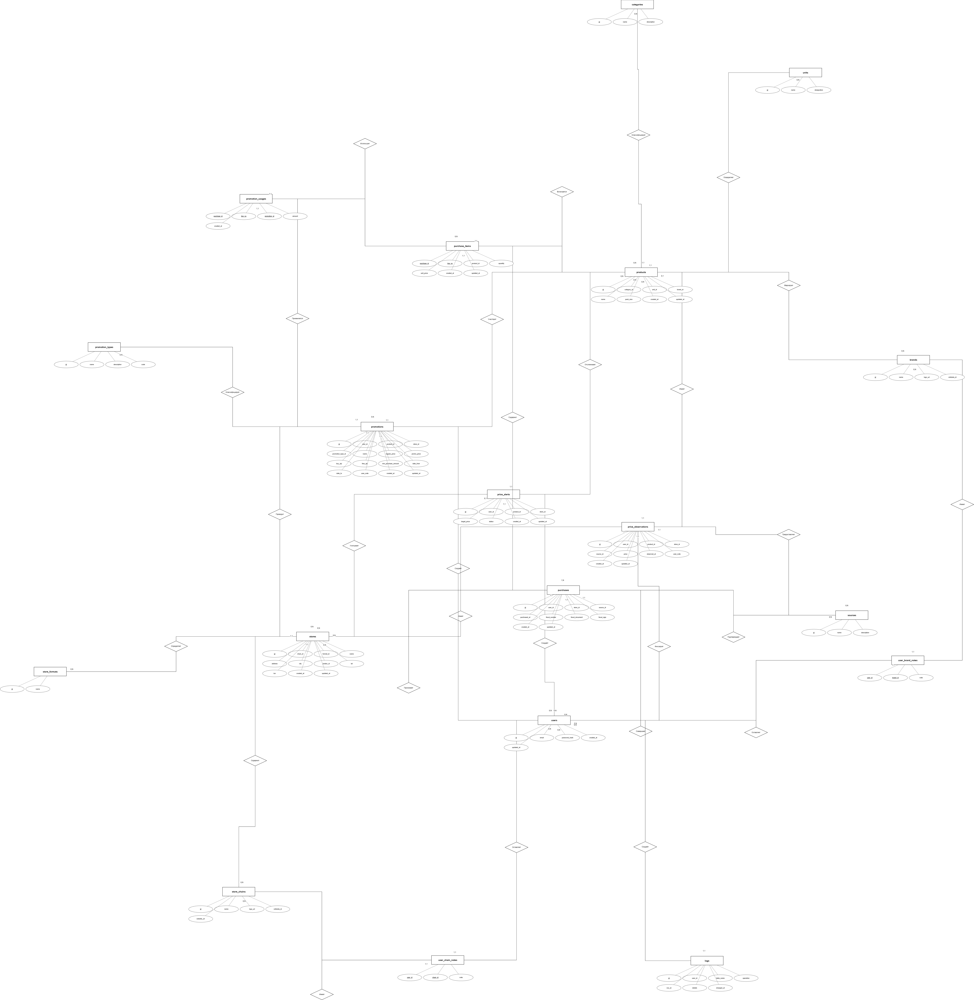
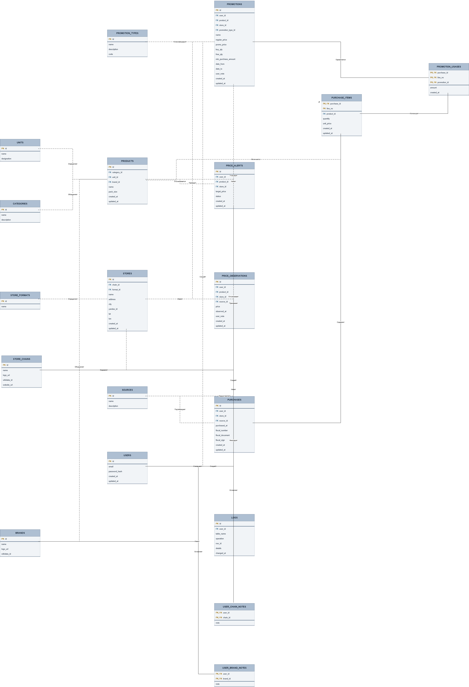

# Отчёт по проектированию базы данных
## Вариант 12. LifePilot — система учёта личных расходов и анализа ценовых предложений

**Предметная область:** учёт личных покупок, наблюдений за ценами и рекламных предложений.  
**СУБД:** PostgreSQL. **Приложение:** ASP.NET Core (Minimal API), HTML/CSS/JavaScript; REST API.

## 1. Описание предметной области и назначение системы
LifePilot — веб-приложение для ведения истории покупок, регистрации цен в магазинах, анализа акций и настройки уведомлений о достижении целевой цены. В перспективе предполагается клиент для Android. Пользователи регистрируются по электронной почте и паролю. Справочники товаров, брендов, категорий, единиц измерения и магазинов являются общими, а покупки, ценовые наблюдения, уведомления и личные заметки относятся к конкретному пользователю.

Основные операции: создание товаров и магазинов; ручное внесение покупок; импорт состава чека по QR-коду ФНС; сохранение цены с датой и источником; регистрация акций и их применения; сравнение цен с нормализацией по единицам измерения; расчёт расходов за период; создание ценовых уведомлений. Адреса магазинов могут геокодироваться через Яндекс.Карты. Автоматический парсинг цен сайтов и банковские интеграции в первую версию не входят.

## 2. Состав сущностей
В проектной модели используется **19 сущностей**. Ниже приведены поля; `PK` означает первичный ключ, `FK` — внешний ключ. Указание `PK, FK` означает участие поля одновременно в составном первичном и внешнем ключах.

- **`users`**: `id` (PK), `email`, `password_hash`, `created_at`, `updated_at`.
- **`store_chains`**: `id` (PK), `name`, `logo_url`, `wikidata_id`, `website_url`.
- **`store_formats`**: `id` (PK), `name`.
- **`brands`**: `id` (PK), `name`, `logo_url`, `wikidata_id`.
- **`categories`**: `id` (PK), `name`, `description`.
- **`units`**: `id` (PK), `name`, `designation`.
- **`products`**: `id` (PK), `name`, `category_id` (FK), `unit_id` (FK), `brand_id` (FK), `pack_size`, `created_at`, `updated_at`.
- **`stores`**: `id` (PK), `chain_id` (FK), `format_id` (FK), `name`, `address`, `city`, `yandex_id`, `lat`, `lon`, `created_at`, `updated_at`, `postal_code`.
- **`sources`**: `id` (PK), `name`, `description`.
- **`purchases`**: `id` (PK), `user_id` (FK), `store_id` (FK), `source_id` (FK), `purchased_at`, `user_note`, `fiscal_number`, `fiscal_document`, `fiscal_sign`, `created_at`, `updated_at`.
- **`purchase_items`**: `purchase_id` (PK, FK), `line_no` (PK), `product_id` (FK), `quantity`, `unit_price`, `created_at`, `updated_at`.
- **`price_observations`**: `id` (PK), `user_id` (FK), `product_id` (FK), `store_id` (FK), `source_id` (FK), `price`, `observed_at`, `user_note`, `created_at`, `updated_at`.
- **`promotion_types`**: `id` (PK), `name`, `code`, `description`.
- **`promotions`**: `id` (PK), `user_id` (FK), `product_id` (FK), `store_id` (FK), `promotion_type_id` (FK), `name`, `regular_price`, `promo_price`, `buy_qty`, `free_qty`, `min_purchase_amount`, `date_from`, `date_to`, `user_note`, `created_at`, `updated_at`.
- **`promotion_usages`**: `purchase_id` (PK, FK), `line_no` (PK, FK), `promotion_id` (PK, FK), `amount`, `created_at`, `updated_at`.
- **`price_alerts`**: `id` (PK), `user_id` (FK), `product_id` (FK), `store_id` (FK), `target_price`, `status`, `created_at`, `updated_at`.
- **`logs`**: `id` (PK), `table_name`, `operation`, `row_id`, `details`, `changed_at`, `user_id` (FK).
- **`user_brand_notes`**: `user_id` (PK, FK), `brand_id` (PK, FK), `note`.
- **`user_chain_notes`**: `user_id` (PK, FK), `chain_id` (PK, FK), `note`.

### 2.1. Классификация сущностей
- **Стержневые и самостоятельные:** `users`, `products`, `stores`, `purchases`, `price_observations`, `promotions`, `price_alerts`. Они имеют собственные идентификаторы и фиксируют самостоятельные объекты либо события предметной области.
- **Справочные:** `store_chains`, `store_formats`, `brands`, `categories`, `units`, `sources`, `promotion_types`.
- **Зависимые и ассоциативные:** `purchase_items`, `promotion_usages`, `user_brand_notes`, `user_chain_notes`. Их составные ключи включают внешние ключи родительских сущностей.
- **Служебная:** `logs` — аудит операций над данными.

## 3. Инфологическая модель в нотации Питера Чена — Кириллова
Сущности обозначаются прямоугольниками, атрибуты — овалами, отношения — ромбами. Ключевые атрибуты подчёркиваются. Кардинальности проставляются у концов отношений между сущностями, а **не** у соединений сущности с атрибутами. В концептуальной схеме допустимо не дублировать внешние ключи овалами: их смысл выражают отношения.

## 4. Логическая модель в нотации IDEF1X
В IDEF1X атрибуты первичного ключа располагаются над разделительной чертой; остальные атрибуты, включая внешние ключи, не входящие в PK, — под ней. Идентифицирующие отношения используются, когда внешний ключ родителя входит в первичный ключ дочерней сущности. В этой модели такие отношения характерны для `purchase_items`, `promotion_usages`, `user_brand_notes`, `user_chain_notes`. Для прочих FK используются неидентифицирующие отношения.

### 4.1. Основные связи
| Родительская сущность | Дочерняя сущность | Внешний ключ дочерней сущности | Тип |
|---|---|---|---|
| `store_chains` | `stores` | `chain_id` | Неидентифицирующая |
| `store_formats` | `stores` | `format_id` | Неидентифицирующая |
| `categories` | `products` | `category_id` | Неидентифицирующая |
| `units` | `products` | `unit_id` | Неидентифицирующая |
| `brands` | `products` | `brand_id` | Неидентифицирующая |
| `users` | `user_chain_notes` | `user_id` | Идентифицирующая |
| `store_chains` | `user_chain_notes` | `chain_id` | Идентифицирующая |
| `users` | `user_brand_notes` | `user_id` | Идентифицирующая |
| `brands` | `user_brand_notes` | `brand_id` | Идентифицирующая |
| `users` | `logs` | `user_id` | Неидентифицирующая |
| `users` | `purchases` | `user_id` | Неидентифицирующая |
| `stores` | `purchases` | `store_id` | Неидентифицирующая |
| `sources` | `purchases` | `source_id` | Неидентифицирующая |
| `users` | `price_alerts` | `user_id` | Неидентифицирующая |
| `products` | `price_alerts` | `product_id` | Неидентифицирующая |
| `stores` | `price_alerts` | `store_id` | Неидентифицирующая |
| `users` | `price_observations` | `user_id` | Неидентифицирующая |
| `products` | `price_observations` | `product_id` | Неидентифицирующая |
| `stores` | `price_observations` | `store_id` | Неидентифицирующая |
| `sources` | `price_observations` | `source_id` | Неидентифицирующая |
| `users` | `promotions` | `user_id` | Неидентифицирующая |
| `products` | `promotions` | `product_id` | Неидентифицирующая |
| `stores` | `promotions` | `store_id` | Неидентифицирующая |
| `promotion_types` | `promotions` | `promotion_type_id` | Неидентифицирующая |
| `purchases` | `purchase_items` | `purchase_id` | Идентифицирующая |
| `products` | `purchase_items` | `product_id` | Неидентифицирующая |
| `purchase_items` | `promotion_usages` | `(purchase_id, line_no)` | Идентифицирующая |
| `promotions` | `promotion_usages` | `promotion_id` | Идентифицирующая |

## 5. Словарь данных и ограничения целостности
Обозначения: `+` — да, `−` — нет. «Обяз.» означает запрет `NULL` для атрибута. Состав ограничений отражает исходный словарь; спорные проектные допущения вынесены в раздел 7.

### 5.1. `users`
| Атрибут | Тип данных | PK | FK | Обяз. | Ограничения | Происхождение |
|---|---|:---:|:---:|:---:|---|---|
| `id` | INTEGER | + | − | + | Уникален, автоинкремент | Собственный |
| `email` | VARCHAR(255) | − | − | + | Уникален (UNIQUE) | Собственный |
| `password_hash` | VARCHAR(255) | − | − | + | Хэш пароля | Собственный |
| `created_at` | TIMESTAMPTZ | − | − | + | По умолчанию `now()` | Собственный |
| `updated_at` | TIMESTAMPTZ | − | − | + | По умолчанию `now()` | Собственный |

### 5.2. `store_chains`
| Атрибут | Тип данных | PK | FK | Обяз. | Ограничения | Происхождение |
|---|---|:---:|:---:|:---:|---|---|
| `id` | INTEGER | + | − | + | Уникален, автоинкремент | Собственный |
| `name` | VARCHAR(100) | − | − | + | Уникален (UNIQUE) | Собственный |
| `logo_url` | VARCHAR(255) | − | − | − | - | Собственный |
| `wikidata_id` | VARCHAR(20) | − | − | − | Уникален (UNIQUE) | Собственный |
| `website_url` | VARCHAR(255) | − | − | − | - | Собственный |

### 5.3. `store_formats`
| Атрибут | Тип данных | PK | FK | Обяз. | Ограничения | Происхождение |
|---|---|:---:|:---:|:---:|---|---|
| `id` | INTEGER | + | − | + | Уникален, автоинкремент | Собственный |
| `name` | VARCHAR(50) | − | − | + | Уникален, `CHECK` из списка | Собственный |

### 5.4. `brands`
| Атрибут | Тип данных | PK | FK | Обяз. | Ограничения | Происхождение |
|---|---|:---:|:---:|:---:|---|---|
| `id` | INTEGER | + | − | + | Уникален, автоинкремент | Собственный |
| `name` | VARCHAR(100) | − | − | + | Уникален (UNIQUE) | Собственный |
| `logo_url` | VARCHAR(255) | − | − | − | - | Собственный |
| `wikidata_id` | VARCHAR(20) | − | − | − | Уникален (UNIQUE) | Собственный |

### 5.5. `categories`
| Атрибут | Тип данных | PK | FK | Обяз. | Ограничения | Происхождение |
|---|---|:---:|:---:|:---:|---|---|
| `id` | INTEGER | + | − | + | Уникален, автоинкремент | Собственный |
| `name` | VARCHAR(100) | − | − | + | Уникален (UNIQUE) | Собственный |
| `description` | TEXT | − | − | − | - | Собственный |

### 5.6. `units`
| Атрибут | Тип данных | PK | FK | Обяз. | Ограничения | Происхождение |
|---|---|:---:|:---:|:---:|---|---|
| `id` | INTEGER | + | − | + | Уникален, автоинкремент | Собственный |
| `name` | VARCHAR(50) | − | − | + | - | Собственный |
| `designation` | VARCHAR(10) | − | − | + | Уникален (UNIQUE) | Собственный |

### 5.7. `products`
| Атрибут | Тип данных | PK | FK | Обяз. | Ограничения | Происхождение |
|---|---|:---:|:---:|:---:|---|---|
| `id` | INTEGER | + | − | + | Уникален, автоинкремент | Собственный |
| `name` | VARCHAR(255) | − | − | + | - | Собственный |
| `category_id` | INTEGER | − | + | + | Соответствует PK `categories.id` | Внешний |
| `unit_id` | INTEGER | − | + | + | Соответствует PK `units.id` | Внешний |
| `brand_id` | INTEGER | − | + | − | Соответствует PK `brands.id` | Внешний |
| `pack_size` | NUMERIC(10,3) | − | − | + | `CHECK` > 0, по умолчанию 1 | Собственный |
| `created_at` | TIMESTAMPTZ | − | − | + | По умолчанию `now()` | Собственный |
| `updated_at` | TIMESTAMPTZ | − | − | + | По умолчанию `now()` | Собственный |

### 5.8. `stores`
| Атрибут | Тип данных | PK | FK | Обяз. | Ограничения | Происхождение |
|---|---|:---:|:---:|:---:|---|---|
| `id` | INTEGER | + | − | + | Уникален, автоинкремент | Собственный |
| `chain_id` | INTEGER | − | + | + | Соответствует PK `store_chains.id` | Внешний |
| `format_id` | INTEGER | − | + | + | Соответствует PK `store_formats.id` | Внешний |
| `name` | VARCHAR(100) | − | − | + | - | Собственный |
| `address` | TEXT | − | − | + | - | Собственный |
| `city` | VARCHAR(100) | − | − | + | - | Собственный |
| `yandex_id` | VARCHAR(50) | − | − | − | Уникален (UNIQUE) | Собственный |
| `lat` | NUMERIC(10,7) | − | − | − | `CHECK` от -90 до 90 | Собственный |
| `lon` | NUMERIC(10,7) | − | − | − | `CHECK` от -180 до 180 | Собственный |
| `created_at` | TIMESTAMPTZ | − | − | + | По умолчанию `now()` | Собственный |
| `updated_at` | TIMESTAMPTZ | − | − | + | По умолчанию `now()` | Собственный |
| `postal_code` | VARCHAR(20) | − | − | − | Почтовый индекс; при наличии | Собственный |

### 5.9. `sources`
| Атрибут | Тип данных | PK | FK | Обяз. | Ограничения | Происхождение |
|---|---|:---:|:---:|:---:|---|---|
| `id` | INTEGER | + | − | + | Уникален, автоинкремент | Собственный |
| `name` | VARCHAR(50) | − | − | + | Уникален (UNIQUE) | Собственный |
| `description` | TEXT | − | − | − | - | Собственный |

### 5.10. `purchases`
| Атрибут | Тип данных | PK | FK | Обяз. | Ограничения | Происхождение |
|---|---|:---:|:---:|:---:|---|---|
| `id` | INTEGER | + | − | + | Уникален, автоинкремент | Собственный |
| `user_id` | INTEGER | − | + | + | Соответствует PK `users.id` | Внешний |
| `store_id` | INTEGER | − | + | + | Соответствует PK `stores.id` | Внешний |
| `source_id` | INTEGER | − | + | − | Соответствует PK `sources.id` | Внешний |
| `purchased_at` | TIMESTAMPTZ | − | − | + | По умолчанию `now()` | Собственный |
| `user_note` | TEXT | − | − | − | - | Собственный |
| `fiscal_number` | VARCHAR(50) | − | − | − | - | Собственный |
| `fiscal_document` | VARCHAR(50) | − | − | − | - | Собственный |
| `fiscal_sign` | VARCHAR(50) | − | − | − | Уникален (UNIQUE) | Собственный |
| `created_at` | TIMESTAMPTZ | − | − | + | По умолчанию `now()` | Собственный |
| `updated_at` | TIMESTAMPTZ | − | − | + | По умолчанию `now()` | Собственный |

### 5.11. `purchase_items`
| Атрибут | Тип данных | PK | FK | Обяз. | Ограничения | Происхождение |
|---|---|:---:|:---:|:---:|---|---|
| `purchase_id` | INTEGER | + | + | + | Часть составного PK, соответствует PK `purchases.id` | Внешний |
| `line_no` | INTEGER | + | − | + | Часть составного PK, номер строки в чеке | Собственный |
| `product_id` | INTEGER | − | + | + | Соответствует PK `products.id` | Внешний |
| `quantity` | NUMERIC(10,3) | − | − | + | `CHECK` > 0 | Собственный |
| `unit_price` | NUMERIC(10,2) | − | − | + | `CHECK` >= 0 | Собственный |
| `created_at` | TIMESTAMPTZ | − | − | + | По умолчанию `now()` | Собственный |
| `updated_at` | TIMESTAMPTZ | − | − | + | По умолчанию `now()` | Собственный |

### 5.12. `price_observations`
| Атрибут | Тип данных | PK | FK | Обяз. | Ограничения | Происхождение |
|---|---|:---:|:---:|:---:|---|---|
| `id` | INTEGER | + | − | + | Уникален, автоинкремент | Собственный |
| `user_id` | INTEGER | − | + | + | Соответствует PK `users.id` | Внешний |
| `product_id` | INTEGER | − | + | + | Соответствует PK `products.id` | Внешний |
| `store_id` | INTEGER | − | + | + | Соответствует PK `stores.id` | Внешний |
| `source_id` | INTEGER | − | + | − | Соответствует PK `sources.id` | Внешний |
| `price` | NUMERIC(10,2) | − | − | + | `CHECK` > 0 | Собственный |
| `observed_at` | TIMESTAMPTZ | − | − | + | По умолчанию `now()` | Собственный |
| `user_note` | TEXT | − | − | − | - | Собственный |
| `created_at` | TIMESTAMPTZ | − | − | + | По умолчанию `now()` | Собственный |
| `updated_at` | TIMESTAMPTZ | − | − | + | По умолчанию `now()` | Собственный |

### 5.13. `promotion_types`
| Атрибут | Тип данных | PK | FK | Обяз. | Ограничения | Происхождение |
|---|---|:---:|:---:|:---:|---|---|
| `id` | INTEGER | + | − | + | Уникален, автоинкремент | Собственный |
| `name` | VARCHAR(50) | − | − | + | Уникален (UNIQUE) | Собственный |
| `code` | VARCHAR(20) | − | − | + | Уникален, `CHECK` из списка | Собственный |
| `description` | TEXT | − | − | − | - | Собственный |

### 5.14. `promotions`
| Атрибут | Тип данных | PK | FK | Обяз. | Ограничения | Происхождение |
|---|---|:---:|:---:|:---:|---|---|
| `id` | INTEGER | + | − | + | Уникален, автоинкремент | Собственный |
| `user_id` | INTEGER | − | + | + | Соответствует PK `users.id` | Внешний |
| `product_id` | INTEGER | − | + | + | Соответствует PK `products.id` | Внешний |
| `store_id` | INTEGER | − | + | + | Соответствует PK `stores.id` | Внешний |
| `promotion_type_id` | INTEGER | − | + | + | Соответствует PK `promotion_types.id` | Внешний |
| `name` | VARCHAR(200) | − | − | + | - | Собственный |
| `regular_price` | NUMERIC(10,2) | − | − | + | `CHECK` > 0 | Собственный |
| `promo_price` | NUMERIC(10,2) | − | − | − | `CHECK` > 0 | Собственный |
| `buy_qty` | INTEGER | − | − | − | `CHECK` > 0 | Собственный |
| `free_qty` | INTEGER | − | − | − | `CHECK` > 0 | Собственный |
| `min_purchase_amount` | NUMERIC(10,2) | − | − | − | `CHECK` > 0 | Собственный |
| `date_from` | DATE | − | − | + | - | Собственный |
| `date_to` | DATE | − | − | + | `CHECK` > `date_from` | Собственный |
| `user_note` | TEXT | − | − | − | - | Собственный |
| `created_at` | TIMESTAMPTZ | − | − | + | По умолчанию `now()` | Собственный |
| `updated_at` | TIMESTAMPTZ | − | − | + | По умолчанию `now()` | Собственный |

### 5.15. `promotion_usages`
| Атрибут | Тип данных | PK | FK | Обяз. | Ограничения | Происхождение |
|---|---|:---:|:---:|:---:|---|---|
| `purchase_id` | INTEGER | + | + | + | Часть составного PK, соответствует `purchase_items.purchase_id` | Внешний |
| `line_no` | INTEGER | + | + | + | Часть составного PK, соответствует `purchase_items.line_no` | Внешний |
| `promotion_id` | INTEGER | + | + | + | Часть составного PK, соответствует PK `promotions.id` | Внешний |
| `amount` | NUMERIC(10,2) | − | − | + | `CHECK` >= 0 (сумма скидки) | Собственный |
| `created_at` | TIMESTAMPTZ | − | − | + | По умолчанию `now()` | Собственный |
| `updated_at` | TIMESTAMPTZ | − | − | + | По умолчанию `now()` | Собственный |

### 5.16. `price_alerts`
| Атрибут | Тип данных | PK | FK | Обяз. | Ограничения | Происхождение |
|---|---|:---:|:---:|:---:|---|---|
| `id` | INTEGER | + | − | + | Уникален, автоинкремент | Собственный |
| `user_id` | INTEGER | − | + | + | Соответствует PK `users.id` | Внешний |
| `product_id` | INTEGER | − | + | + | Соответствует PK `products.id` | Внешний |
| `store_id` | INTEGER | − | + | − | Соответствует PK `stores.id` | Внешний |
| `target_price` | NUMERIC(10,2) | − | − | + | `CHECK` > 0 | Собственный |
| `status` | VARCHAR(20) | − | − | + | `CHECK` ('active', 'triggered', 'dismissed') | Собственный |
| `created_at` | TIMESTAMPTZ | − | − | + | По умолчанию `now()` | Собственный |
| `updated_at` | TIMESTAMPTZ | − | − | + | По умолчанию `now()` | Собственный |

### 5.17. `logs`
| Атрибут | Тип данных | PK | FK | Обяз. | Ограничения | Происхождение |
|---|---|:---:|:---:|:---:|---|---|
| `id` | BIGINT | + | − | + | Уникален, автоинкремент | Собственный |
| `table_name` | VARCHAR(50) | − | − | + | - | Собственный |
| `operation` | VARCHAR(10) | − | − | + | `CHECK` ('INSERT', 'UPDATE', 'DELETE') | Собственный |
| `row_id` | INTEGER | − | − | − | - | Собственный |
| `details` | TEXT | − | − | − | - | Собственный |
| `changed_at` | TIMESTAMPTZ | − | − | + | По умолчанию `now()` | Собственный |
| `user_id` | INTEGER | − | + | − | Соответствует PK `users.id` | Внешний |

### 5.18. `user_brand_notes`
| Атрибут | Тип данных | PK | FK | Обяз. | Ограничения | Происхождение |
|---|---|:---:|:---:|:---:|---|---|
| `user_id` | INTEGER | + | + | + | Часть составного PK, соответствует PK `users.id` | Внешний |
| `brand_id` | INTEGER | + | + | + | Часть составного PK, соответствует PK `brands.id` | Внешний |
| `note` | TEXT | − | − | − | - | Собственный |

### 5.19. `user_chain_notes`
| Атрибут | Тип данных | PK | FK | Обяз. | Ограничения | Происхождение |
|---|---|:---:|:---:|:---:|---|---|
| `user_id` | INTEGER | + | + | + | Часть составного PK, соответствует PK `users.id` | Внешний |
| `chain_id` | INTEGER | + | + | + | Часть составного PK, соответствует PK `store_chains.id` | Внешний |
| `note` | TEXT | − | − | − | - | Собственный |

### 5.20. Дополнительные ограничения на уровне таблиц
- `purchase_items`: `PRIMARY KEY (purchase_id, line_no)`; `FOREIGN KEY (purchase_id) REFERENCES purchases(id)`; `FOREIGN KEY (product_id) REFERENCES products(id)`; `CHECK (line_no > 0)`.
- `promotion_usages`: `PRIMARY KEY (purchase_id, line_no, promotion_id)`; составной `FOREIGN KEY (purchase_id, line_no) REFERENCES purchase_items(purchase_id, line_no)`; `FOREIGN KEY (promotion_id) REFERENCES promotions(id)`.
- `user_brand_notes`: `PRIMARY KEY (user_id, brand_id)`; оба атрибута являются внешними ключами.
- `user_chain_notes`: `PRIMARY KEY (user_id, chain_id)`; оба атрибута являются внешними ключами.
- Для `promotions` необходимо проверить условие `date_to >= date_from` (если однодневные акции разрешены; иначе `>`).
- В PostgreSQL ограничения `UNIQUE`, `CHECK`, `NOT NULL` и внешние ключи должны быть реализованы в DDL; наличие их в словаре само по себе не обеспечивает контроль данных.

## 6. Алгоритмические связи и вычисляемые показатели
### 6.1. Общая сумма покупки
Сумма покупки без отдельного учёта скидок вычисляется по строкам чека:

\[S_{purchase}=\sum_{i=1}^{n} quantity_i\cdot unit\_price_i\]

Если `unit_price` уже является фактической ценой после скидки, вычитать `promotion_usages.amount` повторно нельзя. Если `unit_price` хранит цену до скидки, модель должна явно закрепить соответствующее правило.

### 6.2. Цена за базовую единицу измерения

\[P_{base}=\frac{price}{pack\_size\cdot k}\]

Здесь `k` — коэффициент перевода единицы, в которой задана упаковка, к выбранной базовой единице. Например, для сравнения в рублях за килограмм 500 г соответствует 0,5 кг. Сравнение допустимо только для совместимых единиц измерения (масса с массой, объём с объёмом, штуки со штуками).

### 6.3. Процент скидки
Для акций с заданными обычной и акционной ценами:

\[D=\frac{regular\_price-promo\_price}{regular\_price}\cdot100\%\]

Поле `discount_percent` исключено из согласованной структуры как дублирующее вычисляемое значение. Для иных механик (`1+1`, скидка при достижении суммы) выгода рассчитывается по специальным правилам типа акции.

### 6.4. Экономия по применённым акциям

\[Savings=\sum amount\]

Суммирование производится по `promotion_usages` через связанные `purchase_items` и `purchases` с фильтрацией по `user_id` и периоду `purchased_at`. Для корректности нужно определить, является ли `amount` скидкой на строку покупки и допускается ли несколько акций на одну строку.

## 7. Принятые проектные решения и вопросы для согласования
В исходном черновике были противоречия между кратким перечнем полей и словарём данных. Для согласованности с ранее построенной IDEF1X-моделью **приняты следующие решения**, которые следует подтвердить перед реализацией:

1. `purchase_items` использует составной PK `(purchase_id, line_no)`, а не отдельный `id`.
2. `promotion_usages` использует составной PK `(purchase_id, line_no, promotion_id)`, а не `id` и `purchase_item_id`.
3. Личные заметки удалены из общих справочников `brands`, `store_chains`, `products`, `stores`. Для брендов и сетей используются `user_brand_notes`, `user_chain_notes`; при необходимости заметок к товарам и магазинам следует ввести дополнительные таблицы.
4. `discount_percent` не хранится как отдельное поле, если он вычисляется из двух цен. Сложные механики акций требуют отдельной логики.
5. `products.brand_id` необязателен. `price_alerts.store_id` необязателен, чтобы отслеживать цену товара независимо от магазина. `sources` у покупки и наблюдения в исходном словаре также допускает `NULL`; это нужно подтвердить правилами ввода.
6. Для `stores.postal_code` и `purchases.user_note` сохранены атрибуты, упомянутые в первоначальном перечне. `promotion_usages.updated_at` сохранён по словарю данных.
7. Запрет пустых покупок (не менее одной строки в `purchase_items`) — бизнес-правило приложения, которое требует отдельной проверки при завершении создания покупки; один внешний ключ не обеспечивает его автоматически.
8. Для импорта чеков ФНС необходимо определить правило защиты от повторного импорта: одного `fiscal_sign` может быть недостаточно для однозначного идентификатора чека.

## 8. Заключение
Разработана согласованная модель данных LifePilot, включающая 19 сущностей и 28 связей. Она охватывает общие справочники товаров и магазинов, персональные покупки и ценовые наблюдения, рекламные предложения, ценовые уведомления и аудит изменений. Составные ключи используются для позиций покупок, применений акций и пользовательских заметок к справочникам. Вычисляемые показатели (суммы, нормализованные цены, проценты скидок и экономия) не требуют обязательного дублирования в БД. Следующий этап — проверка бизнес-ограничений и реализация DDL-скриптов PostgreSQL.

---
*Документ подготовлен на основе предоставленного черновика и обсуждённой модели LifePilot. Места для двух диаграмм оставлены намеренно: изображения необходимо вставить после визуальной проверки экспортов draw.io.*
